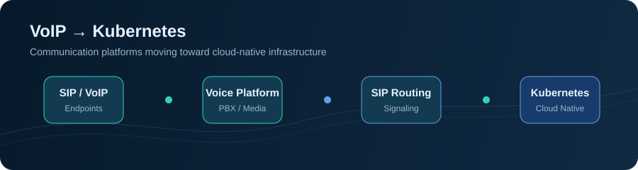

# Hi, I'm Víctor Araya 👋

  

## VoIP & Telecom Engineer | Kubernetes Direction

I build and operate communication platforms based on **VoIP, SIP, Asterisk, Kamailio, and messaging technologies**.

My professional direction is to bring reliable telecom workloads to **Kubernetes and cloud-native environments**, with a focus on reproducible deployments, scalability, and operational simplicity.

## About me

- 📞 VoIP and telecommunications are my main area of expertise
- 📡 Working with SIP, Asterisk, Kamailio, and real-time communication platforms
- 📨 Building and integrating SMS solutions with Jasmin SMS Gateway
- ☸️ Moving communication workloads toward Kubernetes-based deployments
- ☁️ Exploring AWS and cloud infrastructure for telecom platforms
- 🔧 Automating infrastructure with Terraform, Ansible, Docker, and GitHub Actions
- 🐍 Building supporting tools and web platforms with Python and Django

## Technical focus

  
  
  
  
  
  
  
  
  
  

**Main expertise:** VoIP, SIP infrastructure, Asterisk, Kamailio, and communication platforms.

**Current direction:** deploying telecom workloads with Kubernetes and cloud-native infrastructure.

## Featured projects

### VoIP, Telecom & Messaging

- 📞 [Ansible Homelab](https://github.com/varayaIII/ansible-homelab) — AWS-based lab for automating Asterisk and Kamailio infrastructure.
- 📨 [Jasmin Web Panel](https://github.com/varayaIII/jasmin-web-panel) — Web management platform for Jasmin SMS Gateway, including monitoring, connectors, routing, and message tracking.
- 💬 [Hub4Talk](https://github.com/varayaIII/hub4talk) — Personal communication and messaging project.
- 📡 [Jasmin POC](https://github.com/varayaIII/jasmin_poc) — Proof of concept and experimentation with Jasmin SMS Gateway.

### Kubernetes & Cloud-Native Infrastructure

- ☸️ [Terraform NGINX Module](https://github.com/varayaIII/terraform-nginx-module) — Reusable Kubernetes infrastructure with Terratest validation and CI/CD.
- 🚀 [Pipeline CI/CD + GitOps](https://github.com/varayaIII/pipeline-cicd-gitops) — Container delivery workflow using GitHub Actions, GHCR, Kubernetes, Kustomize, and Argo CD.
- 🔄 [Argo CD Example Apps](https://github.com/varayaIII/argocd-example-apps) — Declarative Kubernetes deployment examples.

## My direction

I am focused on evolving communication platforms toward Kubernetes and cloud-native architectures, while keeping the operational requirements of VoIP in mind: reliability, observability, scalability, networking, and predictable deployments.

## What I enjoy building

- Reliable VoIP and SIP platforms
- Asterisk and Kamailio integrations
- SMS and messaging infrastructure
- Kubernetes deployments for communication workloads
- Reproducible infrastructure and automation
- Open-source tools for real-world telecom challenges

## Connect with me

- 🌐 [Personal portfolio](https://varayaIII.github.io)
- 💻 [GitHub](https://github.com/varayaIII)

---

  <i>Building communication platforms today. Moving VoIP toward Kubernetes tomorrow.</i>

